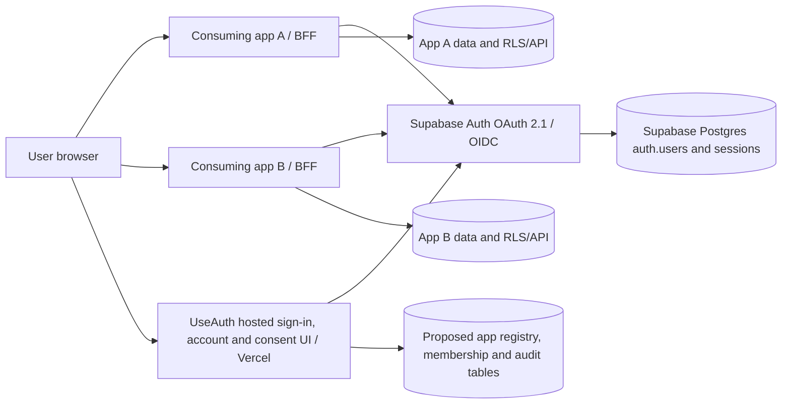

# Proposed centralized authentication architecture

**Historical OAuth proposal (2026-10-25).** The app registry and memberships were implemented in Phase 2. The OAuth server, SDK, and consent screen were not implemented. On 2026-10-26, the owner requested a reliability-first alternative to Supabase OAuth Server beta; [the Phase 3 plan](PHASE3_RELIABLE_AUTH_PLAN.md) is the current roadmap. The OAuth design below remains a reference for a future standards-based SSO pilot, subject to provider and database migration review.

## System boundaries

- **Supabase Auth** remains the identity, password, OTP, refresh-token, OAuth code, access-token and ID-token issuer. No custom hashing, OAuth authorization server, code exchange service, or refresh-token issuer is proposed.
- **UseAuth on Vercel** owns hosted registration/login/recovery/account UI, an OAuth authorization and consent UI, application policy checks, administrative registration UX, and redacted security events. It uses the same Supabase project and a host-only authenticated cookie for its own UI.
- **Consuming applications** are registered OAuth clients. Each owns its app session, business roles/permissions, and data access. A successful UseAuth login proves identity; access to an app requires an active registered app and active membership, which the current test policy grants automatically.
- **Postgres/RLS** is an enforcement boundary for shared Supabase data, not merely a profile store. Existing table policies must be inventoried and amended deliberately. Server APIs must also enforce app access and resource audience; CORS does not authenticate a client.

## Choice of protocol and current limits

Supabase currently documents an **OAuth 2.1/OIDC Server beta** with Authorization Code + PKCE, refresh grant, OIDC discovery, JWKS, exact registered redirect URIs, `client_id` in OAuth access tokens, and `openid` ID tokens. The installed `@supabase/auth-js@2.117.2` exposes `getAuthorizationDetails`, `approveAuthorization`, and `denyAuthorization`. **Project-level enablement and actual behavior are unverified.** The OAuth Server must be enabled in Supabase; its authorization path should point to a UseAuth route such as `/oauth/consent`. The hosted UI authenticates the user, displays verified client details and scopes, applies app-access policy, then calls Supabase's approve/deny methods. Supabase issues the code and tokens. [OAuth overview](https://supabase.com/docs/guides/auth/oauth-server), [flow](https://supabase.com/docs/guides/auth/oauth-server/oauth-flows), [setup](https://supabase.com/docs/guides/auth/oauth-server/getting-started).

OIDC ID tokens require an asymmetric signing key; existing key type is unknown and must be checked before a pilot. If the project's beta capability or signing migration is unavailable or unsuitable for production, pause cross-domain SSO rollout. Continue the existing per-app credential API only as a documented transitional mode, or evaluate a mature external OIDC provider with explicit architectural approval. Do **not** invent a proprietary redirect/token protocol.

## Logical data relationships (not migration DDL)

| Entity                          | Key relationships and purpose                                                                         | Proposed authority                                                            |
| ------------------------------- | ----------------------------------------------------------------------------------------------------- | ----------------------------------------------------------------------------- |
| `auth.users`                    | One identity per user; existing managed table                                                         | Supabase Auth                                                                 |
| `auth.sessions`                 | Supabase sessions and revocation state                                                                | Supabase Auth                                                                 |
| `auth.oauth_clients`            | Client IDs, type, exact redirect URIs, client secrets where confidential                              | Supabase OAuth Server; manage via supported dashboard/API                     |
| `auth_platform.applications`    | Internal app ID, mapped OAuth client ID, display name, owner, environment, active flag, access policy | New controlled platform schema, after live-schema review                      |
| `auth_platform.app_memberships` | `(app_id, user_id)` grant/status and optional app role reference; FK to application and `auth.users`  | New controlled platform schema; deny by default                               |
| `auth_platform.security_events` | Event type, timestamp, pseudonymous actor/app, outcome, request correlation, retention metadata       | New append-only or external logging store; never raw credentials/tokens       |
| Existing `public.usernames`     | Optional unique username tied to `auth.users`                                                         | Preserve current migration and trigger unless live inventory shows a conflict |

Existing app-specific role and permission tables may already live in the shared database. Inventory them first; don't duplicate them merely for uniformity. App owners decide app roles. Platform membership only answers whether the user may enter that app. RLS policies must enforce row ownership **and** allowed OAuth `client_id`/membership where clients directly reach shared Supabase data. Backend-only data services enforce equivalent policy server-side. Service-role or secret keys bypass RLS and must never reach a browser or generic app SDK.

## Authentication and registration flows

1. A user visits UseAuth directly or starts an OAuth authorization request from a registered app.
2. Existing hosted email/password registration calls Supabase `signUp`. Supabase sends confirmation email; UseAuth verifies the one-time hash at `/auth/confirm` and establishes only the UseAuth hosted session. In the current test setup, a confirmed user is automatically enrolled in every active registered app. App access is checked by each consumer; a revoked or missing membership is denied.
3. Hosted login calls Supabase `signInWithPassword` and stores its own session in host-only HttpOnly/Secure/SameSite cookies. `/account` calls `getUser` server-side. A newly introduced resend-verification flow would use Supabase's supported resend method after rate-limit and enumeration review.
4. Existing `/api/v1/auth` credential endpoints remain during migration. They are not SSO and do not identify a registered app. New integrations should use OAuth/OIDC, not copy this contract.

## Authorization Code + PKCE SSO flow

1. App A creates a high-entropy `state`, `nonce` for OIDC, and PKCE verifier/challenge. A confidential Next.js BFF stores verifier/state/nonce in a short-lived, HttpOnly, Secure, SameSite cookie or server-side transaction record bound to that browser; it redirects to Supabase's **authorization endpoint** with its registered `client_id`, exact `redirect_uri`, `response_type=code`, `scope=openid email profile` as needed, and `code_challenge_method=S256`.
2. Supabase validates the client, redirect URI and request, then sends the browser to UseAuth `/oauth/consent?authorization_id=...`. UseAuth retrieves authorization details through Supabase's OAuth API; it never trusts a client name or redirect passed directly by the browser.
3. If there is no valid UseAuth session, redirect to hosted sign-in while retaining the opaque authorization ID in a protected same-origin continuation. After login, re-fetch authorization details; require the mapped app to be active and the user to have a valid membership or reviewed self-enrollment policy. Display client name, scopes, and destination. Deny on unknown/inactive app or denied membership. Record a redacted event.
4. UseAuth calls Supabase `approveAuthorization` or `denyAuthorization` and redirects to the URL returned by Supabase. Supabase creates a single-use, short-lived code bound to PKCE and the exact registered redirect. UseAuth does not mint or inspect the code.
5. App A's callback checks state against its transaction, exchanges the code and PKCE verifier at Supabase's token endpoint, validates ID token issuer, signature, expiration, `aud=client_id`, and nonce via OIDC discovery/JWKS, then creates **App A's own** host-only session. It stores refresh material server-side or in an encrypted, HttpOnly server-managed store. Clear one-time transaction state. No refresh token goes to browser localStorage.
6. App B repeats the same standards flow. The existing UseAuth hosted session can make the second login prompt unnecessary, but App B still gets its own code, tokens, membership decision, consent policy and local session. This is SSO by redirect, not cookie sharing.

Both apps under one parent domain and apps on unrelated domains use this flow. Use host-only cookies for UseAuth and each app; avoid wildcard parent-domain session cookies. Cross-site browser cookie limits do not break the top-level redirect flow, but SameSite behavior and Safari/Chrome handling must be tested. Supabase's own consent behavior, first-party consent skipping, and OAuth beta limitations must be confirmed in a pilot.

## Token validation and authorization

- **ID token** is for App A to identify a user during login. Its audience is the OAuth client ID. Never use it as a generic database access token.
- **OAuth access token** is for resource APIs/Supabase data and contains `client_id`; Supabase documentation shows default `aud: authenticated`, so that value alone does **not** distinguish app A from app B. Check issuer, signature, expiration, token type, client ID, and the resource audience/policy chosen for that API. If a per-resource `aud` is required, design and test a Supabase Custom Access Token Hook. Do not assume `openid/email/profile` scopes grant database permissions. [Supabase token security](https://supabase.com/docs/guides/auth/oauth-server/token-security).
- **Membership/role** should be checked server-side, ideally at request time or with a bounded cache/invalidation design. A stale JWT may outlive membership revocation. RLS on shared tables must incorporate ownership, `client_id`, and current membership where appropriate; database tests must prove app A's token cannot read app B data.
- **Supabase-hosted legacy token** from `/api/v1/auth/sign-in` has no OAuth client binding. Explicitly classify it as legacy in app policies; never silently accept it as an app A OAuth token merely because the JWT is valid.

## Password recovery and session lifecycle

The existing forgot-password flow calls Supabase to email a recovery link, verifies the OTP on UseAuth, sets a short-lived recovery grant, and updates the password through Supabase. Keep that path while replacing origin-only app returns with exact registered HTTPS return targets and integrity-bound app context. Password reset should end the recovery session and surface revocation failure. Email templates, live delivery and replay behavior need end-to-end tests.

Supabase rotates refresh tokens and controls access-token expiry. App BFFs rotate their stored refresh token atomically and prevent concurrent exchanges for the same session. A normal app logout clears that app's local session and revokes its Supabase refresh session if owned by that app. UseAuth hosted logout clears its own cookie/session. A separately labeled “sign out everywhere” action may call global Supabase revocation after product review. Supabase notes already-issued access JWTs remain valid until expiry; sensitive APIs requiring immediate revocation must verify current session status or use a short, bounded acceptance window. There is no implicit, immediate cross-app front-channel logout. [Supabase sessions](https://supabase.com/docs/guides/auth/sessions), [sign-out](https://supabase.com/docs/guides/auth/signout).

## Application registration and operating policy

An authorized platform administrator registers one Supabase OAuth client **per application/environment** (public or confidential) with exact HTTPS redirects, approved ownership, secret storage/rotation and a matching internal app record. Callback URLs in Supabase OAuth client settings are separate from the existing Auth email Redirect URLs. Production forbids wildcard callback URIs. Disable/deactivate a client by blocking consent and API access; determine whether Supabase client revocation and existing refresh sessions also require revocation. Audit all registration, grant, suspension and secret-rotation actions. The current test policy automatically grants membership for active registered apps, including future apps. The owner registers apps through SQL; there is no public self-service registration. Review automatic grants before onboarding real users or third-party apps.

## Failure and abuse handling

| Scenario                                    | Required behavior                                                                                                                         |
| ------------------------------------------- | ----------------------------------------------------------------------------------------------------------------------------------------- |
| Supabase Auth unavailable                   | Fail closed for login, consent, token validation and password operations; show generic retry state and emit a redacted operational event. |
| Unknown, inactive or unmapped client        | Deny authorization before consent approval; do not redirect to an untrusted browser-supplied URI.                                         |
| No app membership                           | Deny without creating app session; allow a separately approved invitation/enrollment path only.                                           |
| Redirect mismatch, state/nonce/PKCE failure | Reject callback or authorization; clear transaction; do not establish app session.                                                        |
| Expired/revoked session                     | Clear local session and initiate a fresh authorization flow; avoid refresh loops.                                                         |
| Membership revoked after token issuance     | Sensitive APIs and RLS perform current policy check or documented bounded cache; measure JWT validity window.                             |
| Email reset link reused or modified         | Supabase OTP rejects replay; app return context is integrity-bound and exact-match; no token appears in consuming-app URL.                |
| App A token sent to App B                   | App B rejects wrong `client_id`/resource audience and cannot query B data through RLS.                                                    |

## Security and delivery gates

UseAuth and consuming apps need CSRF protection for cookie-changing requests and OAuth `state`, content security and no-store headers on sensitive pages, strict URI validation, rate limits, non-enumerating recovery replies, and redacted logs. Test deployment through a staging Supabase project with separate clients and redirects before production. Patch vulnerable dependencies and inventory live RLS before creating app tokens that can reach the shared database. The phased work, acceptance criteria and rollback requirements are in [IMPLEMENTATION_PLAN.md](IMPLEMENTATION_PLAN.md).
